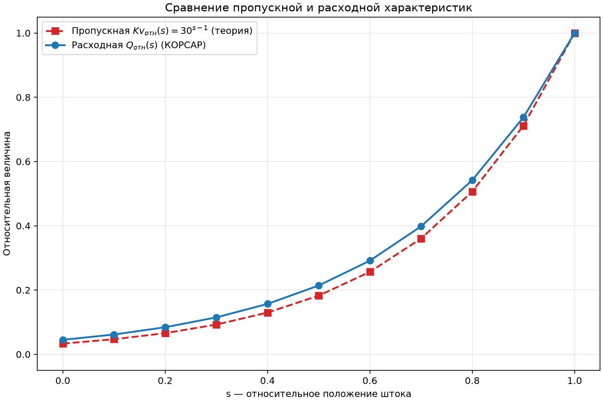
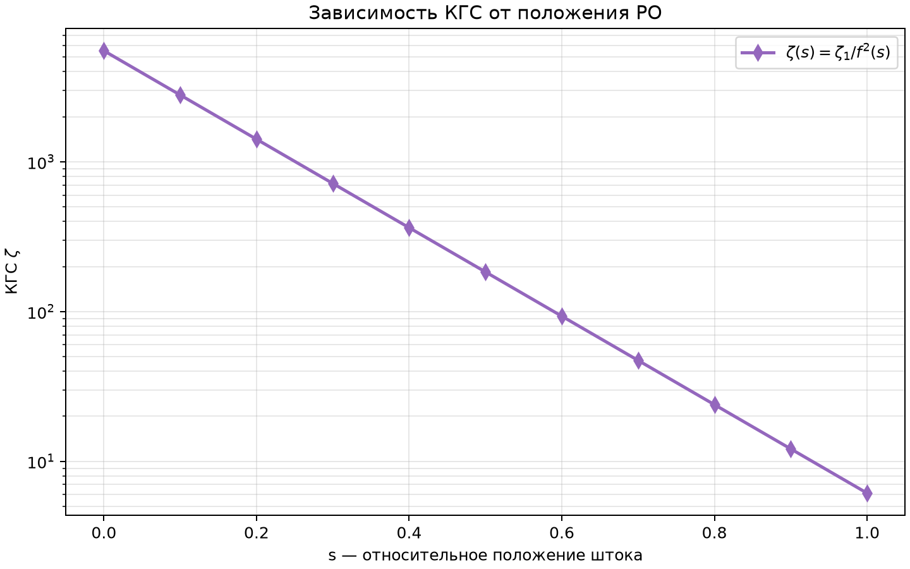

# Лабораторная работа №1. Определение расходной характеристики отдельно стоящей регулирующей арматуры  

## 1. Цель работы  


Целью работы является получение фактической расходной характеристики регулирующей арматуры методом расчетного моделирования в системном теплогидравлическом коде КОРСАР.


### Навыки, приобретаемые по результатам выполнения работы  

>- умение составлять зону задания расчетного варианта кода КОРСАР;  
>- приобретение навыков проверки заданных
характеристик путем тестирования расчетной модели («создание модели — верификация»);  
>- умение работать с элементами CH, VAL, BVOL_T;  
>- умение обрабатывать результаты расчета кода;  
>- умение понимать характеристики, указанные в каталогах регулирующей арматуры.  

---  

## 2. Описание постановки задачи  

В задаче моделируется течение через регулирующий клапан (РК), установленный на участке трубопровода DN50. Длина труб до и после клапана — по 2 м. Течение организовано заданием перепада давления на участке.  

Нодализация расчетного варианта представлена на рисунке ниже:  


Параметры задачи:  

| Параметр | Значение |  
|---|---|  
| Температура потока | 20 °C |  
| Давление на входе | 1.1 МПа |  
| Давление на выходе | 1.0 МПа |  
| Kv_y клапана | 40 |  
| Пропускная характеристика | Равнопроцентная |  
| Условный проход DN | 50 (D = 0.05 м) |  
| Длина трубы | 4 м (2 м до + 2 м после клапана) |  

---  

## 3. Требуемые результаты  

- Определить расходную характеристику РК в абсолютном и относительном виде ($Kv_{отн} = f(s)$), сравнить с пропускной. Определение расходной характеристики произвести путем изменения положения рабочего органа РК и регистрации соответствующего расхода, протекающего через РК и дальнейшей нормировки (при необходимости).  
- Определить зависимость КГС РК от положения регулирующего органа.  

---  

## 4. Ход выполнения работы  

### 4.1. Построение нодализационной схемы  

Схема задачи реализована элементами:  

- BVOL_T1 — заданная граничная ячейка (вход, P = 1.1 МПа, T = 20 °C);  
- CH1 — канал, моделирующий участок трубы DN50 длиной 4 м, разбитый на 20 расчётных ячеек;  
- VAL1 — регулирующий клапан, установленный в 11-м соединении канала CH1 (в середине трубы);  
- BVOL_T2 — заданная граничная ячейка (выход, P = 1.0 МПа, T = 20 °C).  

Процедура LAYOUT имеет вид:  

\`\`\`  
LAYOUT  
CH1/i - BVOL_T1;  
CH1/o - BVOL_T2;  
CH1(11) - VAL1;  
END  
\`\`\`  
### 4.2. Реализация изменений положения клапана  

Для получения расходной характеристики положение штока клапана (s) изменялось ступенчато с шагом 0.1 каждые 2 секунды (11 значений от 0 до 1). Изменение осуществлялось в процедуре EVENT VALVE_MOVE. Расчёт вёлся до FIN_TIM = 30 с, шаг интегрирования — DT_MAX = 0.01 с, вывод результатов — каждые DT_OUT = 0.5 с.  

### 4.3. Особенности версии КОРСАР  

При задании характеристики задвижки через массив F(3, K) элемента VAL было обнаружено, что используемая версия KORSAR (v.035.004) накладывает два ограничения на массив F:  

>1. Все девять значений F(1,1), F(2,1), F(3,1), F(1,2), ..., F(3,3) должны образовывать строго монотонную последовательность в порядке расположения в памяти.  
>2. Каждое значение должно лежать в диапазоне [0, 1].  

Эти ограничения не описаны в руководстве пользователя и были установлены эмпирически. Прямое задание равнопроцентной характеристики через массив F приводит к ошибке компиляции "Element VAL1 Key F: Values are not on ascending order".  

Дополнительно было установлено, что изменение CSI1.VAL1 через EVENT корректно применяется к расчёту. Поэтому характеристика клапана задавалась
принудительно через EVENT VALVE_MOVE — путём задания значения CSI1.VAL1 в соответствии с равнопроцентным законом изменения сопротивления:  

$$
\xi(s) = \frac{\xi_1}{f^2(s)}, \quad f(s) = R^{\,s-1}, \quad R = 30, \quad \xi_1 = 6.13
$$

где $\xi_1$ — коэффициент сопротивления при полном открытии клапана (соответствует $Kv_y = 40$ при DN50).  

Значения $\xi$ в зависимости от $s$:  

| $s$ | 0.0 | 0.1 | 0.2 | 0.3 | 0.4 | 0.5 | 0.6 | 0.7 | 0.8 | 0.9 | 1.0 |  
|:---:|:---:|:---:|:---:|:---:|:---:|:---:|:---:|:---:|:---:|:---:|:---:|  
| $\xi$ | 5517 | 2794.3 | 1415.3 | 716.9 | 363.1 | 183.9 | 93.1 | 47.2 | 23.9 | 12.1 | 6.1 |  

Данный подход эквивалентен заданию массива F: местное сопротивление с переменным $\xi$ создаёт тот же перепад давления при том же расходе, что и РК с соответствующей характеристикой. 

---  

## 5. Получение результатов работы  

Для получения результатов необходимо:  

- Запустить расчёт кода КОРСАР:  

```cmd  
START.bat task result  
```  

- Обработать бинарный файл результатов _korres_ утилитой:  

```cmd  
PROC.bat task result  
```  

- Построить графики при помощи Python-скрипта:  

```cmd  
py task\plot_Q_zeta.py result\out\_sensor_1.dat  
```  

### 5.1. Абсолютная расходная характеристика  

Из полученной таблицы результатов определены установившиеся значения расхода при каждом положении штока. Расход приведён к объёмному виду по формуле:  

$$Q \left[ \frac{\text{м}^3}{\text{ч}} \right] = \frac{d_1}{\rho} \cdot 3600, \quad \rho = 998.2 \ \frac{\text{кг}}{\text{м}^3}$$

Значения абсолютной расходной характеристики:  

| $s$ | $Q$, кг/с | $Q$, м³/ч |  
|:---:|:---:|:---:|  
| 0.0 | 0.671 | 2.42 |  
| 0.1 | 0.920 | 3.32 |  
| 0.2 | 1.256 | 4.53 |  
| 0.3 | 1.714 | 6.18 |  
| 0.4 | 2.340 | 8.44 |  
| 0.5 | 3.195 | 11.52 |  
| 0.6 | 4.349 | 15.69 |  
| 0.7 | 5.944 | 21.44 |  
| 0.8 | 8.088 | 29.17 |  
| 0.9 | 11.009 | 39.70 |  
| 1.0 | 14.925 | 53.83 |  

")

### 5.2. Относительная расходная характеристика  

Относительная расходная характеристика получается нормировкой абсолютного расхода на максимальное значение:  

$$Q_{отн}(s) = \frac{Q(s)}{Q_{max}}, \quad Q_{max} = Q(1.0) = 42.55 \ \text{м}^3/\text{ч}$$

| $s$ | $Q_{отн} = Q/Q_{max}$ |  
|:---:|:---:|  
| 0.0 | 0.045 |  
| 0.1 | 0.062 |  
| 0.2 | 0.084 |  
| 0.3 | 0.115 |  
| 0.4 | 0.157 |  
| 0.5 | 0.214 |  
| 0.6 | 0.291 |  
| 0.7 | 0.398 |  
| 0.8 | 0.542 |  
| 0.9 | 0.738 |  
| 1.0 | 1.000 |  

")

### 5.3. Сравнение расходной и пропускной характеристик  

Пропускная характеристика клапана задана конструктивно как равнопроцентная ($R = 30$):  

$$Kv_{отн}(s) = \frac{Kv(s)}{Kv_y} = 30^{s-1}$$

Сводная таблица значений:  

| $s$ | $Kv_{отн}$ (теория) | $Q_{отн}$ (КОРСАР) |  
|:---:|:---:|:---:|  
| 0.0 | 0.033 | 0.045 |  
| 0.1 | 0.047 | 0.062 |  
| 0.2 | 0.066 | 0.084 |  
| 0.3 | 0.092 | 0.115 |  
| 0.4 | 0.130 | 0.157 |  
| 0.5 | 0.183 | 0.214 |  
| 0.6 | 0.257 | 0.291 |  
| 0.7 | 0.360 | 0.398 |  
| 0.8 | 0.506 | 0.542 |  
| 0.9 | 0.712 | 0.738 |  
| 1.0 | 1.000 | 1.000 |  

Сравнительный график пропускной и расходной характеристик:  



Анализ сравнения:  

>1. _Качественное соответствие_. Обе характеристики имеют нелинейно-возрастающий вид: при малых $s$ относительный расход мал, при $s \to 1$ — резко возрастает. Обе кривые качественно соответствуют равнопроцентному профилю.  

>2. _Количественное расхождение_. Расходная характеристика из КОРСАР лежит выше теоретической пропускной во всём диапазоне $s < 1$.  

>3. _Причина расхождения_. Пропускная характеристика $Kv_{отн}(s)$ отражает сопротивление самого клапана. Расходная $Q_{отн}(s)$ зависит от полного сопротивления системы — включая трение по длине трубы CH1 (4 м). Дополнительное расхождение вносит упрощение: из-за ограничений версии КОРСАР (v.035.004) характеристика задавалась через прямые значения CSI1.VAL1 в процедуре EVENT, а не через табличное задание массива F.  

### 5.4. Зависимость КГС от положения РО  

Коэффициент гидравлического сопротивления клапана $\zeta(s)$ задавался по формуле:  

$$\zeta(s) = \frac{\zeta_1}{f^2(s)}, \quad f(s) = 30^{s-1}, \quad \zeta_1 = 6.13$$

| $s$ | 0.0 | 0.1 | 0.2 | 0.3 | 0.4 | 0.5 | 0.6 | 0.7 | 0.8 | 0.9 | 1.0 |  
|:---:|:---:|:---:|:---:|:---:|:---:|:---:|:---:|:---:|:---:|:---:|:---:|  
| $\zeta$ | 5517 | 2794.3 | 1415.3 | 716.9 | 363.1 | 183.9 | 93.1 | 47.2 | 23.9 | 12.1 | 6.1 |  
 

---  

## 6. Валидация результатов расчета  

Для проверки результатов использовалась формула Бернулли для местного сопротивления:  
$$\Delta P = \xi \cdot \frac{\rho \, v^2}{2} \tag{1}$$

и формула Дарси для потерь по длине:  
$$\Delta P = \lambda \cdot \frac{L}{D} \cdot \frac{\rho \, v^2}{2} \tag{2}$$


### Проверка максимального расхода  

При полностью открытом клапане ($s = 1$) и $\xi = 6{.}1$:  

$$v = \sqrt{\frac{2 \, \Delta P}{\xi \rho}} = \sqrt{\frac{2 \cdot 10^5}{6.1 \cdot 998.2}} \approx 5.73 \ \text{м/с}$$

Объёмный расход:  

$$Q = v \cdot S \cdot 3600 = 5.73 \cdot 1.9635 \cdot 10^{-3} \cdot 3600 \approx 40.5 \ \text{м}^3/\text{ч}$$

Расчёт КОРСАР: $Q \approx 42{,}55$ м³/ч.  

>Расхождение: около 5 %, что объясняется перераспределением перепада давления между клапаном и трубой (часть перепада тратится на трение по длине трубы CH1), а также упрощениями модели.  

---  

## 7. Выводы  

1. Получена абсолютная расходная характеристика регулирующего клапана VAL1 — зависимость расхода $Q$ (м³/ч) от положения штока.  

2. Получена относительная расходная
характеристика $Q_{отн}(s) = Q(s)/Q_{max}$ — безразмерная зависимость, нормированная на максимальный расход.  

3. Выполнено сравнение относительной расходной характеристики $Q_{отн}(s)$ с пропускной характеристикой $Kv_{отн}(s) = 30^{\\,s-1}$. Обе характеристики:  

- качественно совпадают по форме — нелинейно возрастают, характерны для равнопроцентного профиля;  
- сходятся в предельных точках ($s = 0$ и $s = 1$);  
- имеют количественное расхождение до 10 % в среднем диапазоне, объясняемое вкладом сопротивления трубы CH1 в общий перепад давления.  

4. Получена зависимость КГС клапана от положения регулирующего органа: от $\zeta = 5517$ при полностью закрытом клапане до $\zeta = 6{,}1$ при полностью открытом.  

5. Максимальный расход при полном открытии клапана — $Q \approx 42{,}55$ м³/ч при перепаде $\Delta P = 0{,}1$ МПа. Это согласуется с теоретической оценкой по формуле Бернулли (расхождение около 5 %).  

6. Основная задача лабораторной работы решена полностью: получены абсолютная и относительная расходные характеристики, проведено сравнение с пропускной характеристикой, определена зависимость КГС от положения РО, выполнена валидация результатов.  


## 8. Список литературы  

1. КОРСАР/В3. Руководство пользователя. — Сосновый Бор: НИТИ, 2019.  
2. Благов Э.Е., Ивницкий Б.Я. Дроссельно-регулирующая арматура ТЭС и АЭС. — М.: Энергоатомиздат, 1990. — 288 с.  
3. РТМ 108.711.02-79. Арматура энергетическая. Методы определения пропускной способности регулирующих органов и выбор оптимальной расходной характеристики.  
4. Емцев Б.Т. Техническая гидромеханика: учебник для вузов. — 2-е изд., перераб. и доп. — М.:
Машиностроение, 1987. — 440 с.  

---  

## Сокращения и обозначения  

 DN — условный проход;  
 Kv — пропускная способность клапана;  
 Q — объёмный расход;  
 s — относительное положение рабочего органа;  
 КГС — коэффициент гидравлического сопротивления;  
 РК — регулирующий клапан;  
 РО — регулирующий орган.  
 
